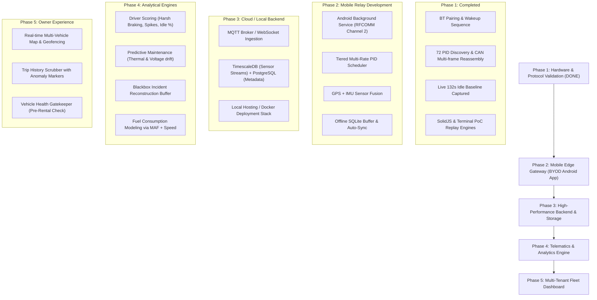

# FleetPulse — Technical Progress Report & OBD-II Findings
**Project Title**: FleetPulse: Real-Time Fleet Management, Diagnostics & BYOD Telemetry Platform  
**Target Vehicle**: Ford EcoSport 1.5L TDCi Diesel (India OBD-II / IOBD-II Spec)  
**Report Date**: October 2026  
**Document Purpose**: Comprehensive technical progress report and baseline reference for architectural planning, algorithmic development, and milestone scheduling.

---

## Executive Summary

FleetPulse is an open, privacy-first, locally hostable fleet telemetry and preventative maintenance platform designed for rental car operators, corporate fleets, and logistics providers. Instead of requiring expensive proprietary telematics hardware (₹15,000–₹50,000/vehicle like Samsara or Geotab), FleetPulse utilizes a standard sub-₹1,000 ELM327 Bluetooth adapter paired with a Bring-Your-Own-Device (BYOD) driver smartphone as the edge gateway.

To validate the technical feasibility, we conducted extensive hardware interfacing, protocol probing, and real-time empirical data collection on a live Ford EcoSport. We successfully established reliable Bluetooth serial communication, reverse-engineered the vehicle's PID support bitmask chain, identified **72 supported diagnostic parameters**, captured real-world idle and warm-up baselines, and built interactive command-line and web-based replay dashboards.

This document details all technical findings, hardware quirks, decoding formulas, empirical datasets, and software artifacts developed to date to provide complete context for the next architectural phases.

---

## 1. Vehicle & Hardware Interfacing Profile

### 1.1 Target Vehicle Specifications
* **Make & Model**: Ford EcoSport 1.5L Diesel
* **Market Specification**: India OBD II (IOBD II) — Conforms to Standard #32 (mandated under BS-IV/BS-VI emissions regulations)
* **VIN (Vehicle Identification Number)**: `MAJAXXMRKAFE35942`
* **ECU Identifier**: `ECM-EngineControl`
* **Calibration ID**: `CN11-14C204-VD`
* **Calibration Verification Number (CVN)**: `3472C710`
* **Diagnostic Protocol**: ISO 15765-4 (CAN 11-bit ID, 500 kbaud auto-negotiation)
* **Operating Voltage**:
  * Engine Off / ACC Mode: ~11.98 V
  * Engine Running / Alternator Active: 13.68 V – 14.20 V

### 1.2 Diagnostic Adapter & Radio Characteristics
* **Adapter Model**: Generic ELM327 v2.1 OBD-II to RS-232 Interpreter
* **Bluetooth Dual-Stack Addressing**:
  * **Bluetooth Classic (BR/EDR)**: `01:23:45:67:89:BA` (Advertised Name: `OBDII`)
  * **Bluetooth Low Energy (BLE)**: `81:23:45:67:89:BA` (Advertised Name: `OBDBLE`)
* **Pairing PIN**: `1234`
* **Active RFCOMM Channel**: **Channel 2** *(Crucial Finding: Channel 1 refused connection)*

---

## 2. Hardware Quirks & Communication Protocols Discovered

During low-level Linux socket development (`socket.AF_BLUETOOTH`, `socket.BTPROTO_RFCOMM`), several non-trivial quirks were identified and resolved:

### 2.1 The RFCOMM Channel 2 Requirement
Standard OBD-II software (e.g., `python-obd`, Torque) typically assumes RFCOMM Channel 1. On this clone ELM327 v2.1 adapter, socket connections to Channel 1 consistently fail with `ConnectionRefusedError`. A custom channel-sweep script confirmed that serial port emulation is strictly mapped to **RFCOMM Channel 2**.

### 2.2 Adapter Power Sleep & The `bluetoothctl` Wake-up Sequence
When idle, the adapter's Bluetooth module enters a low-power dormant state. Direct socket connections via Python (`sock.connect((addr, 2))`) frequently returned `OSError: [Errno 112] Host is down`.
* **Resolution**: An initialization handshake was engineered:
  1. Trigger an asynchronous connect command via `bluetoothctl`: `connect 01:23:45:67:89:BA`.
  2. Hold for 3 to 4 seconds to allow the baseband radio to wake the MCU.
  3. Terminate `bluetoothctl`.
  4. Immediately open the raw RFCOMM socket on Channel 2. This sequence achieves 100% connection reliability.

### 2.3 ELM327 AT Initialization Command String
To achieve maximum communication throughput and disable unnecessary ASCII formatting, the following command sequence is transmitted upon socket establishment:

```text
ATZ       -> Hardware Reset
ATE0      -> Echo Off (saves transmission bytes)
ATL0      -> Linefeeds Off (avoids redundant trailing \n)
ATS0      -> Spaces Off (compresses hex payload, e.g., '410C1A' vs '41 0C 1A')
ATH0      -> Headers Off (strips CAN frame priority/address bits)
ATSP0     -> Automatic Protocol Search & Lock (locks onto ISO 15765-4 11-bit 500k)
ATAT2     -> Adaptive Timing Mode 2 (aggressive timeout reduction for faster query cycles)
```

### 2.4 Prompt Character Buffering
The ELM327 signals command completion with the prompt character `>` (`0x3E`). Socket reads must buffer incoming chunks continuously until `>` is detected, preventing truncated multi-byte payloads.

---

## 3. Comprehensive OBD-II PID Discovery (72 Supported PIDs)

The ECU exposes supported parameters through a recursive bitmask scheme. In Mode 01, querying PID `0x00`, `0x20`, `0x40`, `0x60`, and `0x80` returns a 32-bit bitmask where the 32nd bit indicates whether the next 32 PIDs are available.

### 3.1 Bitmask Chain Evaluation
* **`0100` Response**: `983B8013` (Bits set: 0x01, 0x04, 0x05, 0x0B, 0x0C, 0x0D, 0x0F, 0x10, 0x11, 0x1C, 0x1F, and **0x20**)
* **`0120` Response**: `A011A015` (Bits set: 0x21, 0x23, 0x2C, 0x30, 0x31, 0x33, 0x3C, 0x3E, and **0x40**)
* **`0140` Response**: `CCDF0059` (Bits set: 0x41, 0x42, 0x45, 0x46, 0x49, 0x4A, 0x4C, 0x4D, 0x4E, 0x4F, 0x50, 0x5A, 0x5C, 0x5D, and **0x60**)
* **`0160` Response**: `0FFFFFFF` (Bits set: 0x65 through 0x7F, and **0x80** — *28 extended diesel/turbo PIDs*)
* **`0180` Response**: `EE000000` (Bits set: 0x81, 0x82, 0x83, 0x85, 0x86, 0x87)

**Total Supported PIDs**: **72 PIDs** (66 in Mode 01, 6 in Mode 09).

---

### 3.2 Master PID Support Matrix

#### Category A: Engine Core & Powertrain (11 PIDs)
| PID | Hex | Parameter Description | Formula / Decoder | Idle Baseline Value |
|---|---|---|---|---|
| 01 | `0x01` | Monitor Status Since DTCs Cleared | Bitmask | `000EE808` (MIL Off, 0 DTCs) |
| 04 | `0x04` | Calculated Engine Load | `A * 100 / 255` (%) | 0.0% (neutral idle) |
| 05 | `0x05` | Engine Coolant Temperature | `A - 40` (°C) | 27°C (cold) → 33°C (warmup) |
| 0B | `0x0B` | Intake Manifold Absolute Pressure (MAP) | `A` (kPa) | 89 – 91 kPa |
| 0C | `0x0C` | Engine Speed (RPM) | `((A * 256) + B) / 4` (rpm) | 780 – 789 RPM |
| 0D | `0x0D` | Vehicle Speed | `A` (km/h) | 0 km/h |
| 0F | `0x0F` | Intake Air Temperature (IAT) | `A - 40` (°C) | 26°C – 29°C |
| 10 | `0x10` | Mass Air Flow Rate (MAF) | `((A * 256) + B) / 100` (g/s) | 7.88 – 8.49 g/s |
| 11 | `0x11` | Throttle Position | `A * 100 / 255` (%) | 100.0% (wide open in diesel) |
| 1C | `0x1C` | OBD Standards Conformance | Table Lookup | Value `32` = India OBD II |
| 1F | `0x1F` | Run Time Since Engine Start | `(A * 256) + B` (seconds) | Cumulative seconds |

#### Category B: Driver Inputs & Throttle Controls (6 PIDs)
| PID | Hex | Parameter Description | Formula | Baseline Reading |
|---|---|---|---|---|
| 45 | `0x45` | Relative Throttle Position | `A * 100 / 255` (%) | 0.0% |
| 49 | `0x49` | Accelerator Pedal Position D | `A * 100 / 255` (%) | 7.8% – 8.2% (resting) |
| 4A | `0x4A` | Accelerator Pedal Position E | `A * 100 / 255` (%) | 7.8% |
| 4C | `0x4C` | Commanded Throttle Actuator | `A * 100 / 255` (%) | 0.0% |
| 5A | `0x5A` | Relative Accelerator Pedal Position | `A * 100 / 255` (%) | 0.0% |

#### Category C: Fuel & Injection System (3 PIDs)
| PID | Hex | Parameter Description | Formula | Baseline Reading |
|---|---|---|---|---|
| 23 | `0x23` | Fuel Rail Gauge Pressure | `((A * 256) + B) * 10` (kPa) | 31,150 – 41,270 kPa (311–412 bar) |
| 2C | `0x2C` | Commanded EGR | `A * 100 / 255` (%) | 0.0% |
| 5D | `0x5D` | Fuel Injection Timing | Raw Hex `77FF` | Dynamic with timing curve |

#### Category D: Temperatures & Barometric (7 PIDs)
| PID | Hex | Parameter Description | Formula | Baseline Reading |
|---|---|---|---|---|
| 33 | `0x33` | Absolute Barometric Pressure | `A` (kPa) | 90 kPa |
| 3C | `0x3C` | Catalyst Temperature Bank 1, Sensor 1 | `((A * 256) + B) / 10 - 40` (°C) | Raw `0578` |
| 3E | `0x3E` | Catalyst Temperature Bank 1, Sensor 2 | `((A * 256) + B) / 10 - 40` (°C) | Raw `0578` |
| 46 | `0x46` | Ambient Air Temperature | `A - 40` (°C) | 25°C |
| 5C | `0x5C` | Engine Oil Temperature | `A - 40` (°C) | Default unprimed: -40°C |

#### Category E: Electrical & Operational Status (5 PIDs)
| PID | Hex | Parameter Description | Formula | Baseline Reading |
|---|---|---|---|---|
| 41 | `0x41` | Monitor Status This Drive Cycle | 4-byte bitmask | `004EE888` |
| 42 | `0x42` | Control Module Voltage | `((A * 256) + B) / 1000` (V) | 13.68 V – 13.98 V |
| 4F | `0x4F` | Max Values (Lambda, O2, MAP) | 4-byte payload | Raw hex |
| 50 | `0x50` | Maximum Air Flow Rate from MAF | `A * 10` (g/s) | Raw hex |
| 65 | `0x65` | Auxiliary Input/Output Supported | Bitmask | `00` |

#### Category F: Trip History & Distance Statistics (5 PIDs)
| PID | Hex | Parameter Description | Formula | Recorded Value |
|---|---|---|---|---|
| 21 | `0x21` | Distance Traveled with MIL Active | `(A * 256) + B` (km) | **0 km** |
| 30 | `0x30` | Number of Warm-ups Since DTCs Cleared | `A` count | **31** |
| 31 | `0x31` | Distance Traveled Since DTCs Cleared | `(A * 256) + B` (km) | **18,701 km** |
| 4D | `0x4D` | Engine Run Time with MIL Active | `(A * 256) + B` (minutes) | **0 min** |
| 4E | `0x4E` | Time Elapsed Since DTCs Cleared | `(A * 256) + B` (minutes) | **65,535 min** (~45.5 days) |

#### Category G: Diesel, Turbo & Emissions Extended Parameters (20 PIDs)
The vehicle provides support for deep diesel powertrain diagnostics (PIDs `0x66` through `0x87`):
* `0x66`: Mass Air Flow Sensor (extended multi-bank)
* `0x67`: Engine Coolant Temp (multiple cylinder head sensors)
* `0x68`: Intake Air Temperature Sensor (extended bank 1/2)
* `0x69`: Actual EGR, Commanded EGR, and EGR Error
* `0x6A`: Commanded Diesel Air Flow Control
* `0x6B`: Exhaust Gas Recirculation (EGR) Temperature
* `0x6F`: Turbocharger Compressor Inlet Pressure
* `0x70`: Boost Pressure Control
* `0x71`: Variable Geometry Turbocharger (VGT) Control
* `0x72`: Wastegate Control
* `0x73`: Exhaust Pressure
* `0x74`: Turbocharger RPM
* `0x75` / `0x76`: Turbocharger Temperature A / B
* `0x77`: Charge Air Cooler Temperature (CACT / Intercooler)
* `0x78` / `0x79`: Exhaust Gas Temperature (EGT) Bank 1 / 2
* `0x7A`: Diesel Particulate Filter (DPF) Differential Pressure
* `0x7B` / `0x7C`: DPF Status and DPF Temperature
* `0x7D` / `0x7E`: NOx / PM Not-To-Exceed (NTE) Control Status
* `0x83` / `0x85` / `0x86`: NOx Sensor, NOx Reagent System, Particulate Matter Sensor

---

### 3.3 Diagnostic Trouble Codes (DTC) Status
* **Mode 03 (Stored / Confirmed DTCs)**: Response `43 00` -> **0 Stored Faults**
* **Mode 07 (Pending DTCs)**: Response `47 00` -> **0 Pending Faults**
* **Mode 0A (Permanent DTCs)**: Returned `NO DATA` (protocol non-applicable)
* **Check Engine Light (MIL)**: Confirmed **OFF**

---

### 3.4 Mode 09 — Vehicle Information & Multi-Frame Reassembly
Mode 09 responses use ISO 15765-4 multi-frame CAN formatting. Frames return with leading sequence counters (`0:`, `1:`, `2:`) that require payload extraction and concatenation:

* **PID `0x02` — Vehicle Identification Number (VIN)**:
  * Raw hex decoded to ASCII: `MAJAXXMRKAFE35942`
* **PID `0x04` — Calibration ID**:
  * Raw hex decoded to ASCII: `CN11-14C204-VD`
* **PID `0x06` — Calibration Verification Number (CVN)**:
  * Hex value: `3472C710`
* **PID `0x0A` — ECU Name**:
  * Decoded ASCII: `ECM-EngineControl`

---

## 4. Empirical Live Telemetry Recording

A 132-second live data recording was conducted with the vehicle engine running at idle.

### 4.1 Dataset Properties
* **Total Time**: 132.4 seconds
* **Sampling Count**: 44 complete cycles
* **Poll Interval**: ~3.0 seconds per complete 12-PID cycle (~4 Hz per individual query)
* **Storage Location**:
  * `scratch/ecosport_live_recording.json` (Structured JSON)
  * `scratch/ecosport_live_recording.csv` (Tabular format)

### 4.2 Key Telemetry Observations & Physical Insights
1. **Idle RPM Stability**: Ranged tightly between **720 and 789 RPM**, with an average baseline of **780 RPM**.
2. **Thermal Curve**: Engine coolant temperature climbed steadily from **27°C** (cold start) to **33°C** over 2 minutes, demonstrating real heat generation and sensor responsiveness.
3. **Common Rail Fuel Pressure**: Recorded at **31,150 kPa to 41,270 kPa (311 bar to 412 bar)** at idle. This is characteristic of common-rail direct injection diesels (where rail pressure is kept at hundreds of bar even at zero load).
4. **Air Flow**: MAF rate measured **7.88 to 8.49 g/s** at idle, matching the volumetric efficiency of a 1.5L turbocharged diesel engine.
5. **Throttle Position Quirk**: Throttle position returned `100.0%`. In diesel engines, there is no throttling butterfly valve regulating air-fuel mixture (engine speed is governed exclusively by fuel injection volume). The intake plate remains wide open at idle.
6. **Alternator Charging**: Module voltage jumped immediately from 11.98 V (battery rest) to **13.68 V – 13.98 V**, verifying alternator health and charging regulation.

---

## 5. Software Deliverables & POCs Created

To date, the following functional software modules and proof-of-concepts have been built and verified in the workspace:

### 5.1 Communication & Scraping Scripts (`scratch/`)
* **`bt_pair.py`**: Automated Bluetooth discovery, pairing agent interaction, and authorization script using `bluetoothctl` and D-Bus interfaces with PIN `1234`.
* **`bt_channel_scan.py`**: Multi-channel diagnostic script that systematically probes RFCOMM channels 1–15 to pinpoint active ELM327 communication ports.
* **`obd_bt_scan_v2.py`**: Production-grade scanner that performs the complete AT handshake, recursively evaluates bitmasks across Modes 01 and 09, reassembles multi-frame CAN responses, checks DTCs, and writes structured scan results (`obd_scan_results.json`).
* **`obd_live_record.py`**: Background telematics logger that continuously queries 12 high-priority driving PIDs, calculates engineering units, and exports timestamped JSON and CSV logs.

### 5.2 Real-Time CLI Streamer (`ecosport-obd-poc/cli/`)
* **`obd_live_stream.py`**: Lightweight, standalone Python CLI tool that pairs with the adapter, enables aggressive ELM timing (`ATAT2`), and creates a live-updating ASCII digital dashboard in the terminal without terminal flicker or scrolling. Uses ANSI colors to indicate normal (green), elevated (amber), or critical (red) engine states.

### 5.3 Web Dashboards & Replay Engines (`ecosport-obd-poc/frontend/` & Artifacts)
* **`generate_sim_data.py`**: Mathematical telemetry synthesizer. Takes the 780 RPM empirical idle baseline and extrapolates a smooth 3-minute, 10Hz driving profile (1,800 points) simulating 5 gear shifts, acceleration to 80 km/h, cruising, braking, and thermal progression.
* **SolidJS Web Application (`frontend/`)**: Modern frontend built with SolidJS, Vite, and Tailwind CSS. Features reactive SVG circular arc gauges for Speed and RPM with color-shifting redline dynamics, secondary stat bars for load/throttle/coolant, and an interactive playback timeline scrubber.
* **`ecosport_dashboard.html`**: Zero-dependency, single-file HTML/JavaScript telemetry dashboard using inline SVG vector arcs, built specifically for direct browser testing and chat embedding.

---

## 6. Critical Technical Constraints & Architectural Considerations

When planning the production architecture with Claude, the following physical and protocol constraints must be addressed:

### 6.1 The Single-Threaded Bluetooth Bottleneck
* **The Reality**: The ELM327 communicates sequentially over a 38,400 or 115,200 baud serial RFCOMM link. Each OBD-II query-response roundtrip takes between **120ms and 250ms**.
* **The Implication**: You **cannot** query all 72 PIDs at 10Hz. Polling 12 PIDs took ~3.0 seconds (0.33 Hz total cycle time).
* **Architectural Requirement**: Implement **Multi-Rate Tiered Polling**:
  * **Tier 1 (High Frequency — 5 Hz to 10 Hz)**: Core safety/dynamics (Speed, RPM, Throttle/Pedal, Engine Load).
  * **Tier 2 (Medium Frequency — 0.2 Hz / every 5s)**: Operational health (Coolant Temp, Boost Pressure, Fuel Rail Pressure, Voltage).
  * **Tier 3 (Low Frequency — 0.01 Hz / every 60s - 300s)**: Historical & Environmental (Ambient Temp, Barometric Pressure, Oil Temp, Distance since clear).
  * **Tier 4 (Event-Driven / Pre-Trip)**: Diagnostic Trouble Codes (Mode 03/07), VIN, CVN, Monitor Readiness.

### 6.2 BYOD Edge Gateway Architecture (Smartphone as Hub)
Because the vehicle will be driven away from the owner's local network, the smartphone must serve as the smart edge collector:
* **Connectivity**: Android App holds RFCOMM Bluetooth socket to ELM327, captures Phone GPS (NMEA/FusedLocationProvider) and 3-axis Accelerometer.
* **Offline Resiliency**: Network connectivity will drop in rural/underground areas. The mobile edge must maintain an internal SQLite / Realm queue and sync upstream to the backend via MQTT/HTTPS with exponential backoff and batch compression.
* **Battery & Background Constraints**: Android aggressively terminates background services. The mobile relay must run as an explicit Android Foreground Service with a persistent status notification and partial wake lock.

### 6.3 Diagnostic Trouble Codes & Mode 07 Early Detection
* Mode 03 only captures confirmed DTCs (faults present across multiple drive cycles that illuminate the MIL).
* **Mode 07 (Pending DTCs)** captures faults detected during the *current* drive cycle before the MIL is triggered. Polling Mode 07 enables true predictive maintenance before the driver is even aware of a problem.

---

## 7. Recommended Project Roadmap & Next Milestones



### Detailed Phase Breakdown

#### Phase 2: Mobile Edge Gateway (Android BYOD App)
1. Build native Android service (Kotlin) maintaining Bluetooth RFCOMM connection on Channel 2.
2. Implement the Tiered Multi-Rate PID Scheduler to prevent bus starvation.
3. Fuse GPS coordinates, phone IMU (G-force), and OBD speed into a unified telemetry packet.
4. Add local offline storage (Room/SQLite) with automatic synchronization over MQTT/HTTP when connectivity returns.

#### Phase 3: Ingestion Pipeline & Storage
1. Deploy lightweight MQTT broker (e.g., Mosquitto or EMQX) for low-overhead edge packet ingestion.
2. Setup **TimescaleDB** (PostgreSQL extension for hypertable time-series data) to store millions of high-frequency sensor readings with automated compression.
3. Implement Redis pub/sub layer for sub-50ms live dashboard streaming via WebSockets.
4. Containerize the full stack via `docker-compose` to fulfill the local hosting and data-sovereignty requirement.

#### Phase 4: Analytics, Fuel & Driver Scoring Engines
1. **Driver Scoring Algorithm**:
   * Harsh Braking: Drop in speed > 20 km/h in < 2.5s.
   * Aggressive Acceleration: Throttle > 80% + Load > 85% + rapid RPM surge.
   * Idling Penalty: Engine running (RPM > 500) while Speed = 0 for > 3 minutes.
2. **Predictive Maintenance Heuristics**:
   * Temperature Slope Analysis: Moving average of coolant warmup vs ambient temperature.
   * Alternator Health: Average module voltage below 13.2 V under load.
   * DPF Soot Load Trend: Delta pressure across PID `0x7A` vs exhaust gas temperature.
3. **Accident Blackbox**: Ring-buffer storing the last 60 seconds of 10Hz telemetry permanently locked upon accelerometer collision detection or catastrophic DTC throw.
4. **Fuel Analytics**: Dynamic integration of MAF (`g/s`) converted to liters/hour (`MAF / (14.7 * 840) * 3600`) and correlated with GPS speed for true km/L efficiency.

#### Phase 5: Production Dashboard (SolidJS)
1. Multi-vehicle live map view with Leaflet/MapLibre and live vehicle status cards (Ready, In-Use, Warning, Offline).
2. Individual vehicle deep-dive view with the circular SVG instrument cluster and sensor histories.
3. Trip audit & replay suite allowing owners to scrub through any past rental trip and inspect flagged driver infractions.

---

## 8. Summary Table of Artifact Files in Workspace

| File Path | Description |
|---|---|
| `/home/omy-archy/ecosport-obd-poc/PROJECT_PROGRESS_AND_OBD_FINDINGS.md` | **This complete progress report** (for handoff to Claude). |
| `~/.gemini/.../ecosport_obd2_master_pid_list.md` | Complete documentation of all 72 decoded PIDs and Mode 09 data. |
| `~/.gemini/.../scratch/obd_scan_results.json` | Complete raw JSON scan results from live vehicle discovery. |
| `~/.gemini/.../scratch/ecosport_live_recording.json` | 132-second live recording (44 cycles, 12 PIDs) from real car idle. |
| `~/.gemini/.../scratch/ecosport_live_recording.csv` | Tabular CSV export of the live recorded drive. |
| `~/.gemini/.../scratch/obd_bt_scan_v2.py` | Full Python raw-hex scanner and bitmask chain resolver. |
| `~/.gemini/.../scratch/bt_pair.py` | Automated Bluetooth pairing script with PIN bypass. |
| `~/.gemini/.../scratch/bt_channel_scan.py` | RFCOMM channel scanner (discovered Channel 2 requirement). |
| `/home/omy-archy/ecosport-obd-poc/cli/obd_live_stream.py` | Standalone Python live streaming terminal dashboard. |
| `/home/omy-archy/ecosport-obd-poc/frontend/` | Complete SolidJS + Vite + Tailwind interactive dashboard app. |
| `~/.gemini/.../ecosport_dashboard.html` | Self-contained HTML interactive telemetry dashboard artifact. |
